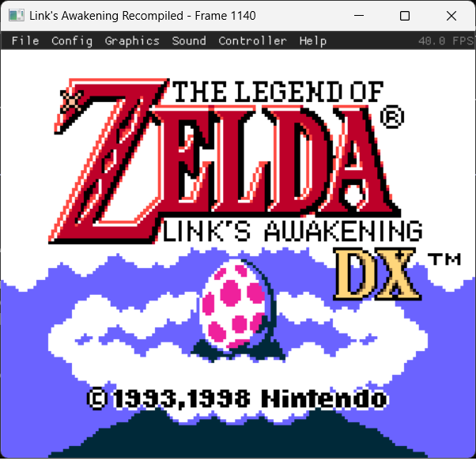
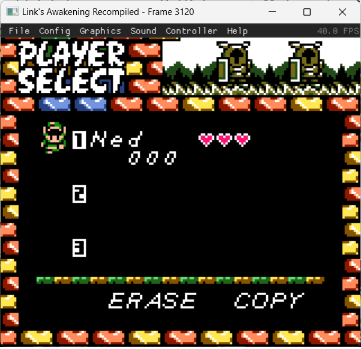
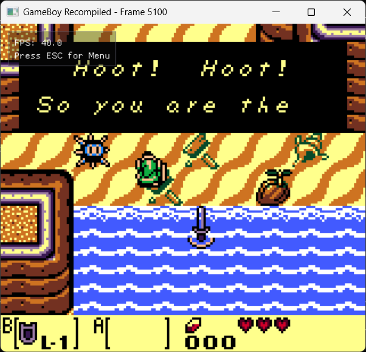
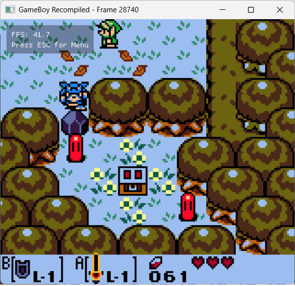
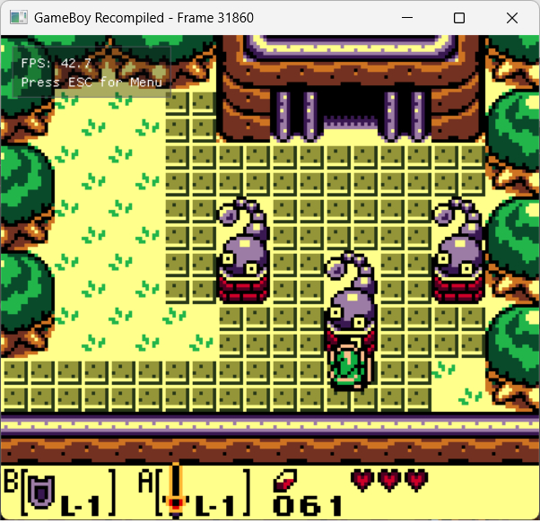
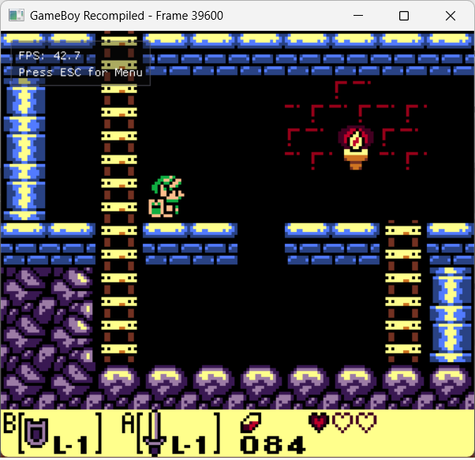

# Link's Awakening DX — Static Recompilation

*The Legend of Zelda: Link's Awakening DX* (Game Boy Color, 1998), recompiled
from the ROM into native C and built as a Windows program. There's no emulator:
the game's code runs as compiled C, with a small interpreter for the few jumps
the recompiler can't resolve ahead of time. You supply your own ROM; no game
code is distributed here.

Part of the sp00nznet recomp projects, built on the
[gb-recompiled](https://github.com/sp00nznet/gb-recompiled) toolkit and following
the same house style as the other recomp repos (generated code is never
committed, `--headless --record` on every port).

## Status

**v0.0.1, usable.** Plays from boot through dungeons on Windows. Single-player
only; the co-op overlay lives in [la-mp](https://github.com/sp00nznet/la-mp).

| Area | State |
|---|---|
| CPU, banking (MBC5), interrupts | Working |
| PPU: CGB palettes, VRAM/WRAM banking, HDMA, double speed | Working |
| Audio (2× pulse, wave, noise) | Working |
| Battery save (SRAM) and save states | Working |
| Keyboard and gamepad, rebindable | Working |
| Headless run and MP4 recording | Working |
| Conformance harness | Not yet (see [ROADMAP.md](ROADMAP.md)) |

Tested ROM: *Legend of Zelda, The - Link's Awakening DX (USA, Europe) (Rev 2)*,
SHA-1 `1c091225688d966928cc74336dbef2e07d12a47c`. Other revisions are untested.

## Screenshots

| Title Screen | File Select | Owl Dialogue |
|--------------|-------------|--------------|
|  |  |  |

| Mysterious Forest | Tail Cave | Side-Scrolling |
|-------------------|-----------|----------------|
|  |  |  |

## Getting Started

You need Windows 10 or 11 and your own Link's Awakening DX ROM (`.gbc`, or a
`.zip` containing one).

### Quick start

1. Download this repo: **Code → Download ZIP**, and unzip it anywhere.
2. Double-click **`Setup.cmd`**.
3. Answer its questions. It installs MSYS2 and the compiler packages if they're
   missing (it asks first), looks for your ROM in Downloads, Desktop and
   Documents (or asks for the path), recompiles it, and builds the game.
   The first build takes 5–15 minutes.
4. Double-click **Link's Awakening DX** in the folder.

If it stops, it prints one line saying what to do, and the details are in
`setup.log`. Rerun `Setup.cmd` after fixing it; finished steps are skipped.

### Step by step

These are the same commands `Setup.cmd` runs.

1. **Install MSYS2** from <https://www.msys2.org> (or `winget install -e --id MSYS2.MSYS2`)
   to `C:\msys64`.
2. **Install the packages** from any terminal:
   ```
   C:\msys64\usr\bin\pacman.exe -S --needed mingw-w64-x86_64-gcc mingw-w64-x86_64-cmake mingw-w64-x86_64-ninja mingw-w64-x86_64-SDL2 git
   ```
3. **Open a terminal with the MinGW tools first on PATH.** In PowerShell:
   ```powershell
   $env:PATH = "C:\msys64\mingw64\bin;C:\msys64\usr\bin;$env:PATH"
   ```
   Trip-up: if `cmake --version` doesn't say it came from `C:\msys64`, another
   CMake is earlier on PATH; open a new window and run the line above again.
4. **Get the source:**
   ```
   git clone --recurse-submodules https://github.com/sp00nznet/LinksAwakening.git
   cd LinksAwakening
   ```
   (Already cloned without submodules? `git submodule update --init --recursive`.
   `Filename too long`? Run `git config --global core.longpaths true` first.)
5. **Copy your ROM** into the folder as `rom.gbc`.
6. **Build the recompiler:**
   ```
   cmake -S gbrecomp -B gbrecomp/build -G Ninja
   cmake --build gbrecomp/build --target gbrecomp
   ```
7. **Recompile the ROM to C** (about 5 seconds):
   ```
   gbrecomp\build\bin\gbrecomp.exe rom.gbc -o gen
   ```
   This writes `gen/rom.c` (~109 MB), `gen/rom_rom.c` and `gen/rom.h`.
8. **Build the game** (5–15 minutes the first time; `rom.c` is one huge file):
   ```
   cmake -S . -B build -G Ninja
   cmake --build build
   ```
9. **Run it:** `build\linksawakening.exe`

## Usage

```
linksawakening.exe [--headless] [--record OUT.mp4] [--frames N]
                   [--input SCRIPT] [--dump-frames DIR] [--screenshot-prefix P]
                   [--trace] [--trace-entries FILE] [--limit N] [--hw-trace FILE]
```

| Flag | Purpose |
|---|---|
| `--headless` | No window and no audio device (safe over RDP); runs at normal speed |
| `--record OUT.mp4` | Pipe every frame to ffmpeg (needs `ffmpeg` on PATH) |
| `--frames N` | Exit after N frames |
| `--input SCRIPT` | Replay a deterministic input script |
| `--dump-frames DIR` | Write every frame as an image into DIR |
| `--screenshot-prefix P` | Prefix for screenshots taken at runtime |
| `--trace` | Runtime instruction trace |
| `--trace-entries FILE` | Per-function trace to FILE |
| `--limit N` | Stop after N instructions (crash bisection) |
| `--hw-trace FILE` | Per-scanline PPU state, to compare against SameBoy ([tools/](tools/README.md)) |

Record the first 30 seconds without opening a window:

```
build\linksawakening.exe --headless --frames 1800 --record intro.mp4
```

### Controls

| Game Boy | Keyboard | Gamepad |
|---|---|---|
| D-pad | Arrows / WASD | D-pad / left stick |
| A | Z / J | A / Cross |
| B | X / K | B / Circle |
| Start | Enter | Start |
| Select | Right Shift | Back / Select |

Save-and-quit combo (A+B+Start+Select) on a gamepad: **A+B+X+Y**. Bindings are
rebindable from the **Controller** menu and saved to `bindings.cfg` next to the
exe. The SRAM save is written next to the exe too.

## Building from source

Step by step above is the build. How the pieces fit together, and why the
generated C never enters the repo, is in [docs/architecture.md](docs/architecture.md).
The SameBoy comparison tools are described in [tools/README.md](tools/README.md).

```
.
├── rom_main.c        entry point and CLI flags
├── CMakeLists.txt    builds gbrecomp/runtime + gen/ into linksawakening.exe
├── Setup.cmd         quick start (runs tools/setup.ps1)
├── gbrecomp/         submodule: sp00nznet/gb-recompiled (recompiler + runtime)
├── gen/              gitignored: recompiler output from your ROM
├── docs/             architecture
└── tools/            setup script, SameBoy tracer, trace comparator
```

## Credits

- Recompiler and runtime: [arcanite24/gb-recompiled](https://github.com/arcanite24/gb-recompiled),
  with our changes in [sp00nznet/gb-recompiled](https://github.com/sp00nznet/gb-recompiled)
- Reference emulator for hardware traces: [SameBoy](https://github.com/LIJI32/SameBoy) by LIJI32 (MIT)
- Game knowledge: the [LADX-Disassembly](https://github.com/zladx/LADX-Disassembly) contributors

## License

The code in this repository is [MIT](LICENSE).

That covers the tools, build files and documentation. It does not and cannot
cover *The Legend of Zelda: Link's Awakening DX* itself: the game's code, art,
audio and data belong to their rights holders, are not distributed here, and
you need your own legitimate copy. The C that the recompiler generates from
your ROM is a derivative of the game, is outside the MIT grant for the same
reason, and is deliberately never committed.
